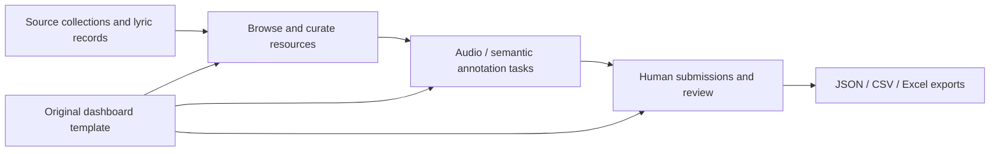

# Folk-song database · selected frontend source

[Open the actual database website](http://115.190.185.154:8081)

This directory provides **selected database interface source**, not a complete deployable database/backend release.

- `index.html`: the original locally supplied Flask/Jinja dashboard template.
- `SOURCE_MANIFEST.json`: file sizes and SHA-256 provenance.

The interface exposes collection/source browsing, lyric-resource curation, audio segment annotation, semantic tasks, review and exports. The template defines the controls and fields used by the existing backend; it does not contain the database itself.

## Data flow

The production `mysql_schema.sql`, `db_utils.py` and `dashboard/app.py` were referenced in earlier local project records but were not found in the current supplied paths. They are **not** reconstructed or represented as included here. The original source location is pending confirmation.

No database dumps, user identities, passwords, cookies, API keys, audio corpus or individual annotation records are included. This is a reading reference for portfolio review; live server actions should be performed only with the owner's own account and authorization.
